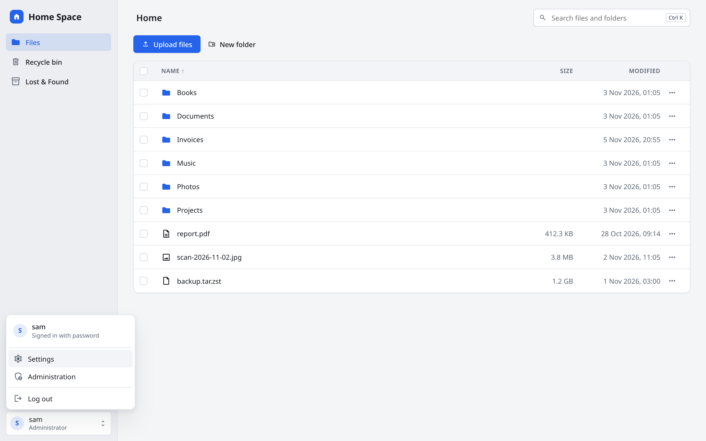
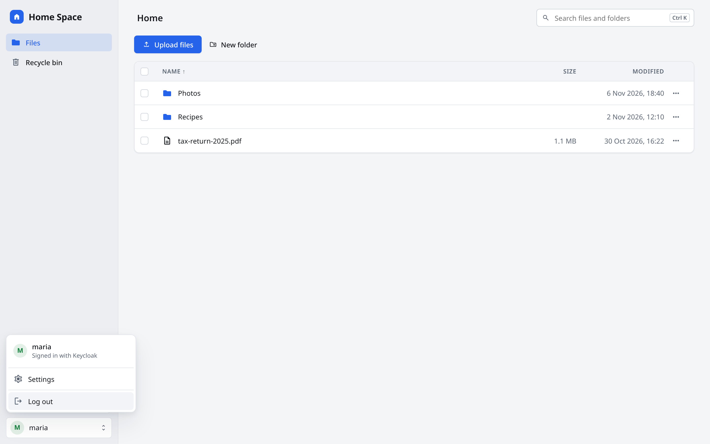
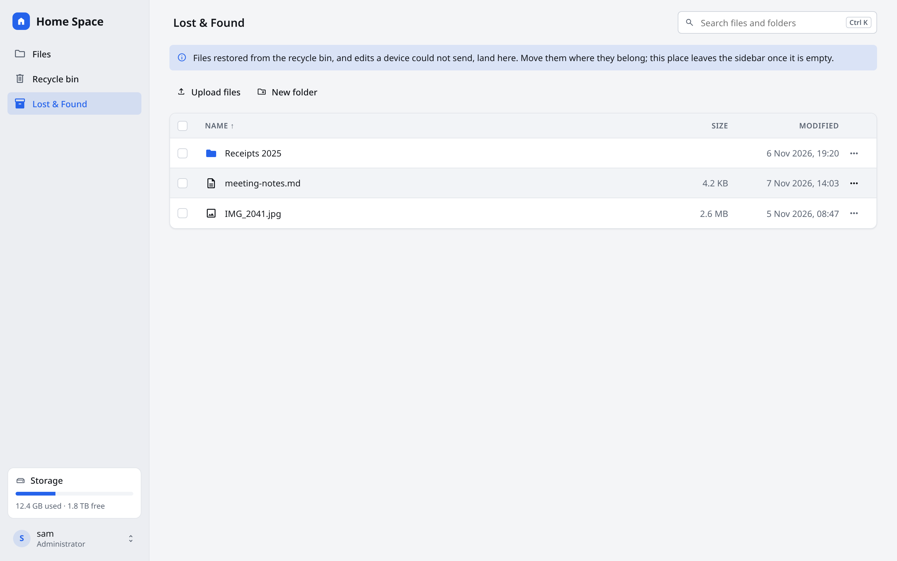
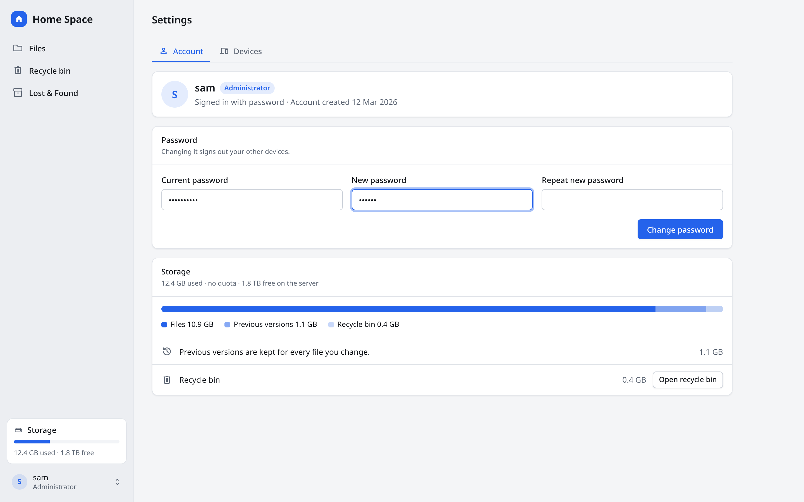
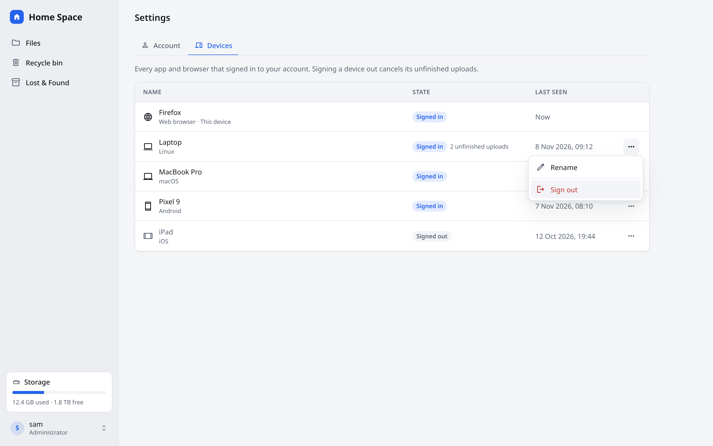
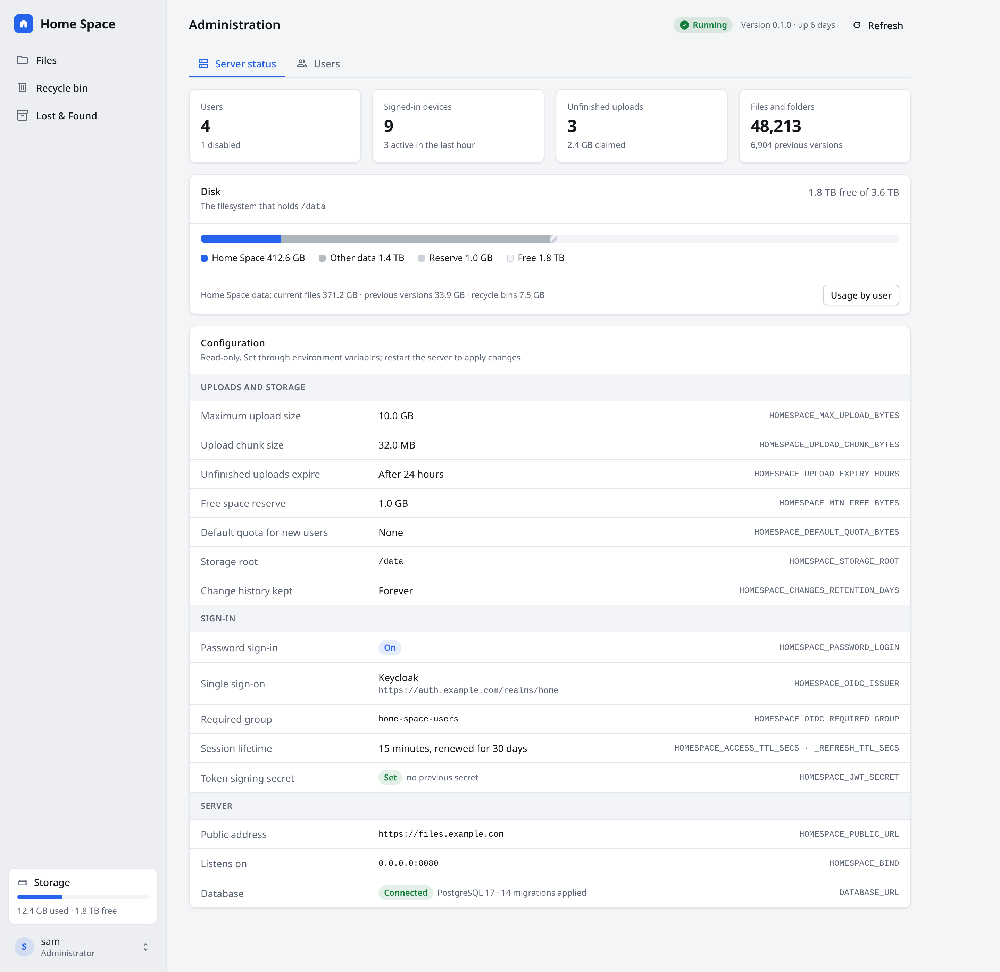
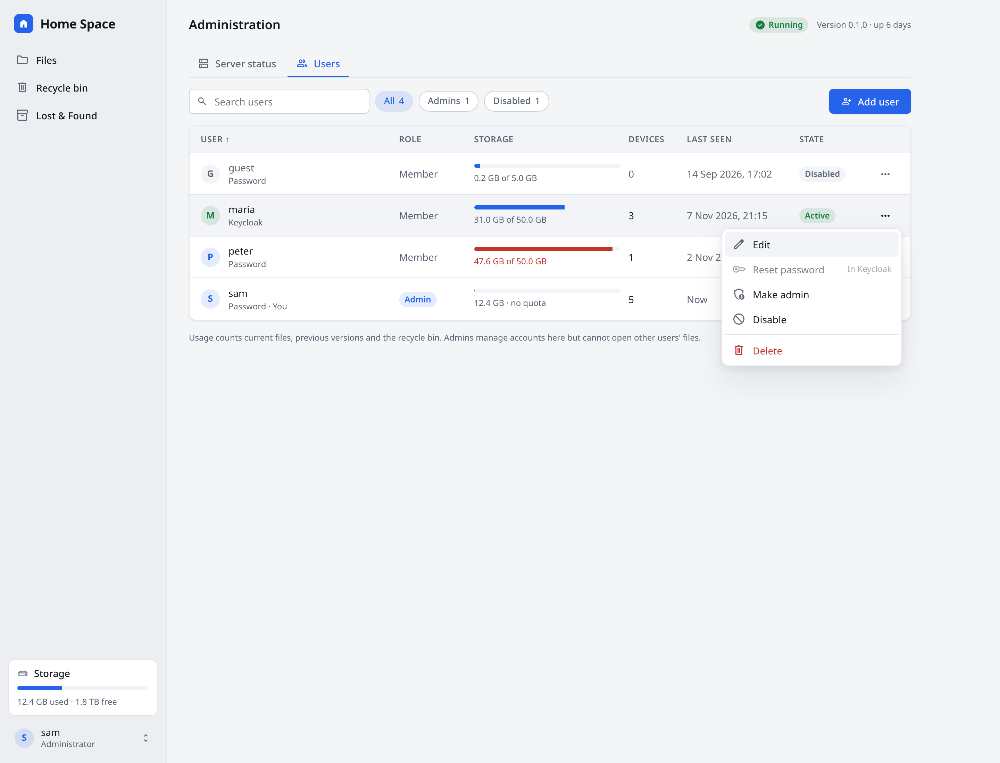
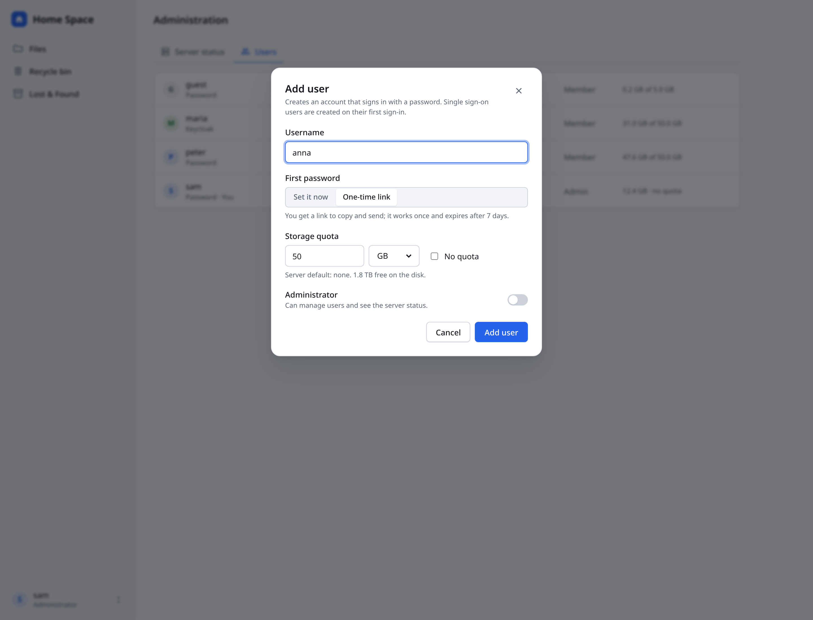
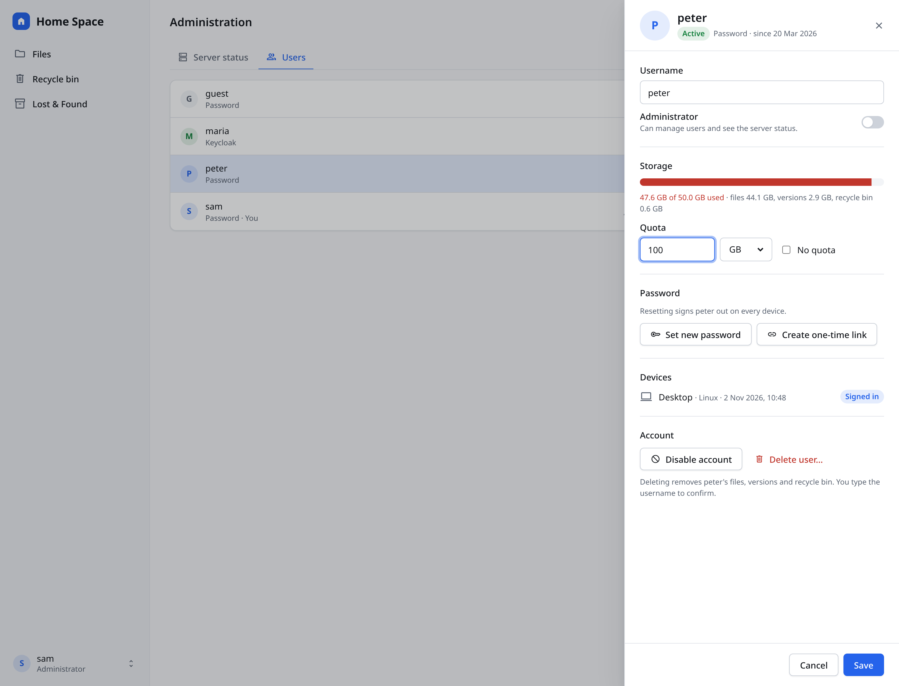

# Web client — settings and administration

Mockups for the web client (`clients/web`): the account menu, user settings (with Devices moved
in) and an administration area for admins. They use the **home-space design system** and the
same frame as the desktop redesign (`../desktop`), so web and desktop look like one product.

- `screens/` — PNG of every screen, light and dark (`<Screen>-light.png`, `<Screen>-dark.png`), 2x, 1440px wide.
- `html/` — the same screens as standalone pages. Open them in a browser; add `dark` to the `.hs`
  element's class to switch theme. They are fluid, so resize the window to check narrow widths.
- `source/` — the editable design canvas (`*.dc.html`, `canvas.json`, `web.css`).
- `tools/` — regenerates `html/` and `screens/` from `source/`.

The live, editable canvas is the Claude design artifact “Home Space Web — settings and
administration”. When it changes, export its `project/` files into `source/` and run the tools
(see Updating).

## Navigation

 



- A sidebar replaces today's app bar: Files, Recycle bin, and Lost & Found (only while it holds
  restored files, as on the desktop). Search moves to the page header.
- Devices leaves the app bar; it is now a tab in Settings.
- Sidebar footer: a storage card (used / free, from `GET /storage`) and the account button.
- The account button opens a menu: name and sign-in method, **Settings**, **Administration**
  (only when `/me` says `is_admin`), **Log out**. A user who is not an admin gets the same menu
  without Administration; the server still answers 403 on `/admin/*`.

## Settings (every user)

 

- `/settings/account`: profile and sign-in method, change password (password users only),
  storage split into files / previous versions / recycle bin.
- `/settings/devices`: today's `/devices` page moved here unchanged (Rename and Sign out in the
  row menu). The old route redirects.

## Administration (admins only)

 

 

- **Server status** (`/admin/status`): counts, disk use (Home Space data / other / reserve /
  free) and the effective configuration, read-only, each next to the environment variable that
  sets it. Secrets show only “Set”.
- **Users** (`/admin/users`): role, sign-in method, usage against the quota, devices, last seen,
  state; filters All / Admins / Disabled; row menu Edit, Reset password, Make admin, Disable,
  Delete. Reset password is disabled for single sign-on users.
- **Add user**: username, first password (set it now or a one-time link), quota, admin switch.
- **Edit user**: a side panel with username, admin, quota, password reset, devices, disable and
  delete (delete asks for the username to be typed).

Based on `docs/todo/admin-panel.md` and `docs/todo/storage-limits.md`.

### Not in the server yet

The admin flag, quotas, `GET /storage` and the `/admin/*` endpoints are still planned. These are
proposals beyond those plans; drop the ones you don't want:

- `HOMESPACE_MIN_FREE_BYTES` and `HOMESPACE_DEFAULT_QUOTA_BYTES` rows on Server status.
- The version, uptime and database status line.
- Groups and the sync ignore list from the admin plan are not designed yet.

### New icons

The web client's icon font is a subset. These screens also use `settings`,
`admin_panel_settings`, `hard_drive`, `unfold_more`, `person`, `person_add`, `group`, `dns`,
`devices`, `logout`, `laptop`, `laptop_mac`, `smartphone`, `tablet`, `language`, `key`, `link`,
`block`, `history`, `refresh`, `search`, `upload`, `create_new_folder`, `inventory_2`, `info`,
`check_circle`, `recycling`; regenerate the subset with the ones you keep.

## Updating

1. Edit the canvas, then copy its `project/*.dc.html`, `project/web.css` and
   `project/canvas.json` into `source/`.
2. Regenerate the pages and images:

   ```sh
   cd docs/designs/web/tools
   npm install
   npx playwright install chromium
   npm run build
   ```

`Main.dc.html` becomes `html/Files.html`. The screenshots pin the font to Noto Sans so they look
the same everywhere; the app itself uses the system UI font. The `.dc.html` files need the canvas
runtime, so open `html/` (not `source/`) in a browser.
